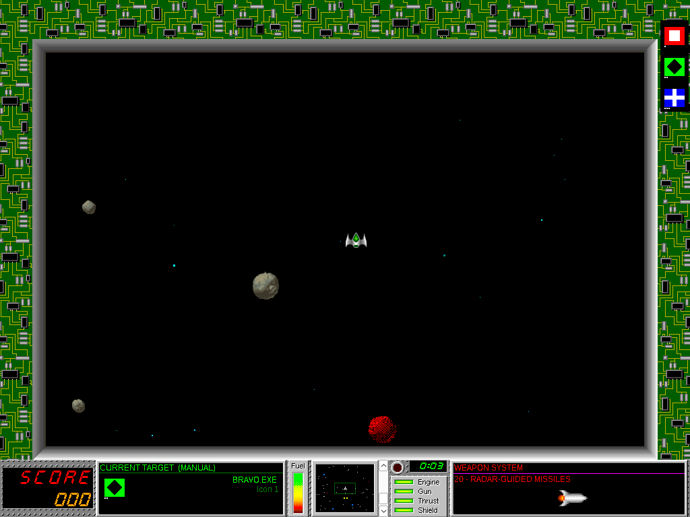
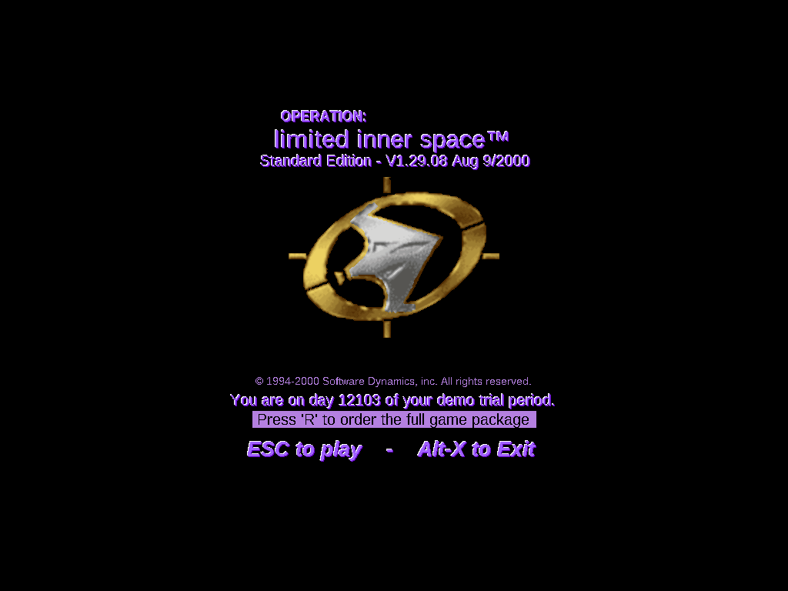
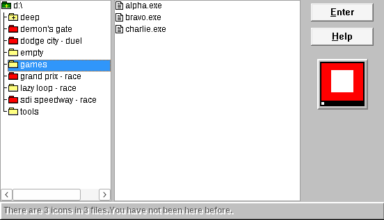
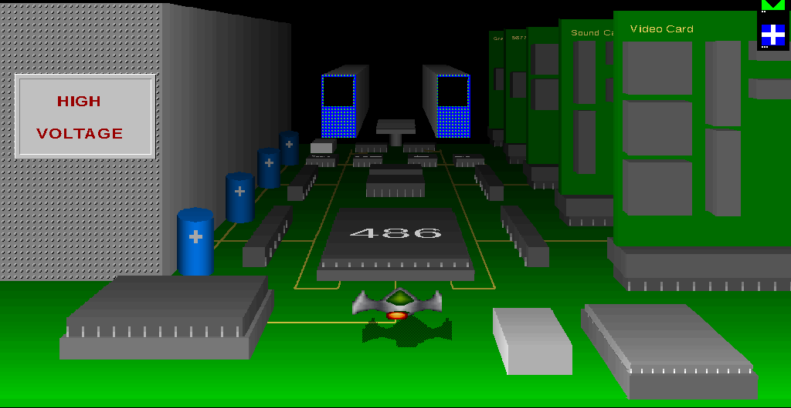
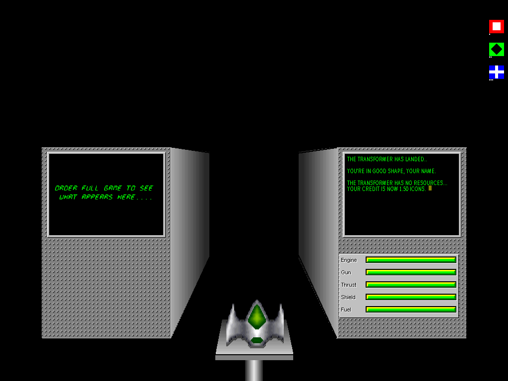

# Operation: Open Space

A faithful Win32 port of **Operation: Inner Space**, the 1994 Windows game that turns your hard disk into outer space.



## What is Inner Space?
Operation: Inner Space (Software Dynamics, Inc., 1994–2000) is a space game played inside your own computer. Each directory on your disk is a wave you fly into from a Navigation window. The icons of the programs in it drift there to be captured or destroyed, alongside rival teams, enforcers, viruses and an Inner Demon.

The original is a 16-bit Windows program. 64-bit Windows cannot run it at all.

## What is this port?
Operation: Open Space is a rewrite of v1.29.08 in C++17 on plain Win32 (GDI and winmm, no engine). It runs natively on Windows 10 and 11, and on Linux through Wine.

- **Faithful first.** The port follows the original's code path by path and is measured against the original, often to the pixel and to 10 ms. A remaster pass comes after the game is complete.
- **Bring your own copy.** The port contains none of the original's files. It installs from and reads your own copy of the game.

## Status
**Early, and playable alone.** You can install, watch the intro, pick a directory and fly a wave: capture icons, shoot, take damage, call the ambulance, save and restore. The other ships and everything that depends on them are still ahead. There is no release build yet, and the port has not been run on real Windows.

| Milestone | Status |
|---|---|
| M1 Foundations: readers for every original file format | Done |
| M2 Shell: window, intro, dialogs, installer, launch scene | Done |
| M3 World: Navigation, wave generation, flight, status display | In progress |
| M4 Core loop: capture, damage, weapons, ambulance, saved games | Done, leftovers in progress |
| M5 Ships and AI: teams, enforcers, laws, hazards | In progress, the player's ship only |
| M6 Specials: races, duels, Inner Demon | Not started |
| M7 Audio: own mixer, MIDI through OPL3 or a SoundFont | Nearly done |
| M8 Extras: Ship Factory, screen savers | Not started |
| M9 Release | Not started |
| M10 Quality pass: the remaster | Not started |

The feature checklist counts 240 of 662 rows ported. [`docs/PLAN.md`](docs/PLAN.md) holds each stage's results and open items, and [`docs/spec/checklist.md`](docs/spec/checklist.md) the status of every feature.

## Screenshots
All taken from the port.

| | |
|---|---|
|  |  |
| The title | The Navigation window: pick a directory to fly into |
|  |  |
| Flying into the ambulance | Inside: repairs, fuel and weapons for credit |

## How it is made
- **The original's bytes are the specification.** One command regenerates the disassembly, decompiled C, manual and assets from the original files ([`re/README.md`](re/README.md)).
- **The original is the referee.** It runs under Wine as a scripted reference, the oracle, which records traces, timings and screenshots for comparison ([`docs/re/oracle.md`](docs/re/oracle.md)).
- **Every reading is checked twice.** A claim about what the code does enters [`docs/re/`](docs/re/) only after an independent verifier confirms it from the bytes, and each claim carries a tag naming its evidence.
- **Deviations are written down.** Where the port must differ from a 1994 program, a decision record in [`docs/decisions/`](docs/decisions/) says why.

## Building
The port builds with MinGW-w64 GCC, and CTest runs the Windows tests under Wine.

```sh
cmake --preset mingw-x64
cmake --build --preset mingw-x64
ctest --preset mingw-x64
```

The `mingw-i686` preset builds the 32-bit program the same way. The `host` preset builds the portable libraries and their tests natively, for quick iteration.

To run it, install from your copy of the game, then start it:

```sh
inspace.exe --install <your game files> --to <dir>
inspace.exe --game <dir>
```

## Original files
To work on the port you need your own copy of the game, v1.29.08 (its `INSTALL.INI` says `V=12908`), and The Works! add-on for the Ship Factory work. Put the game's 25 files in `original/game/` and The Works' files in `original/theworks/`, then check them:

```sh
sha256sum -c original.sha256
```

## Layout
| Path | Contents |
|---|---|
| `src/`, `tests/`, `tools/` | The C++17 port, its tests and the `isview` asset viewer |
| `docs/` | Plan, feature checklist, reverse-engineering reference, design decisions ([map](docs/README.md)) |
| `re/` | Reverse-engineering tools (`isre`), Ghidra scripts and their tests |
| `oracle/` | Scripts that run the original under Wine, and the digests of those runs |
| `original/` | Your original game files. Not committed |
| `work/` | Regenerated outputs. Not committed |

## License
The port's own code and documents are MIT licensed ([`LICENSE`](LICENSE)).

## Legal
This is an independent, non-commercial reimplementation. Operation: Inner Space, its artwork and its assets are © Software Dynamics, Inc. The screenshots above show that artwork as the port draws it from the author's files.
